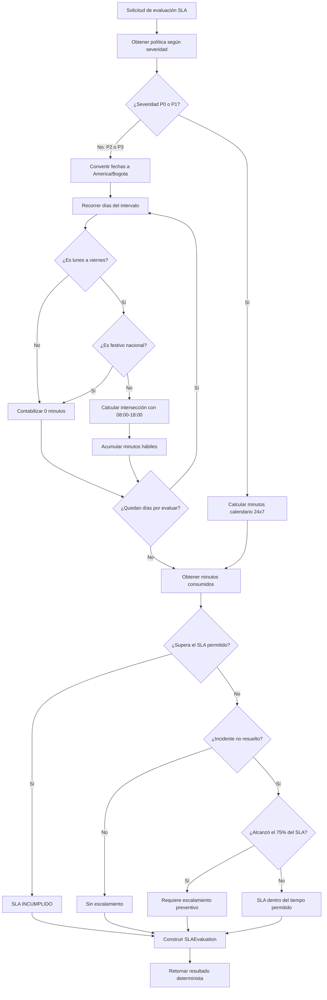

# ADR-002: Cálculo de SLA con horario hábil y festivos colombianos

- **Estado**: Aceptado
- **Fecha**: 2026-11-16
- **Autor(es)**: Equipo IncidentOps
- **Componentes Afectados**: `src/sla_calculator.py`, `src/models.py`, `src/colombian_calendar.py`, `src/working_time_calculator.py`, `src/holidays.py`, `tests/`

---

## 1. Contexto y Problema

Actualmente, la función `evaluate_sla_status()` calcula el tiempo transcurrido entre la creación y la resolución de un incidente mediante la diferencia directa entre dos marcas de tiempo. Este comportamiento contabiliza todos los minutos calendario, independientemente de fines de semana, festivos u horarios laborales.

Esta implementación es adecuada para los incidentes críticos P0 y P1, cuyos acuerdos de nivel de servicio operan continuamente durante las 24 horas del día, los 7 días de la semana (24x7). Sin embargo, no representa correctamente las condiciones operativas de los niveles P2 y P3, que deben contabilizar únicamente el tiempo dentro del horario laboral.

Se requiere modificar el cálculo para aplicar las siguientes políticas:

| Severidad | Tiempo máximo de resolución | Modalidad de cálculo |
|---|---:|---|
| P0 | 60 minutos | Calendario 24x7 |
| P1 | 240 minutos | Calendario 24x7 |
| P2 | 480 minutos | Horario hábil |
| P3 | 1440 minutos | Horario hábil |

Para P2 y P3, el horario hábil corresponde a lunes a viernes, de 08:00 a 18:00, excluyendo los festivos nacionales de Colombia.

El calendario de festivos debe contemplar las disposiciones de la Ley 51 de 1983 (Ley Emiliani), incluyendo:

- Festivos de fecha fija que no se trasladan.
- Festivos trasladables al lunes siguiente según la legislación colombiana.
- Festivos religiosos sujetos a la regla de traslado.
- Festivos religiosos calculados a partir de la fecha de Pascua, como Jueves Santo, Viernes Santo, Ascensión, Corpus Christi y Sagrado Corazón.

La solución debe calcular los festivos dinámicamente para cualquier año requerido, sin depender de archivos o listas anuales mantenidas manualmente.

También se establecen las siguientes restricciones:

- No incorporar dependencias externas adicionales.
- Mantener el comportamiento actual de P0 y P1.
- Garantizar resultados deterministas para una misma incidencia y referencia temporal.
- Utilizar la zona horaria `America/Bogota` para las operaciones de calendario.
- Considerar inicialmente únicamente festivos nacionales, sin excepciones municipales.
- Mantener separadas las responsabilidades de políticas SLA, calendario colombiano, generación de festivos y cálculo del tiempo hábil.

## 2. Opciones Consideradas

### 1. Opción A — Mantener el cálculo de tiempo calendario para todos los niveles

- **Ventajas**:
  - No requiere modificaciones significativas.
  - Mantiene la implementación actual.
  - Tiene una complejidad computacional mínima.
  - No introduce nuevos componentes.

- **Desventajas**:
  - No representa correctamente los acuerdos de servicio de P2 y P3.
  - Penaliza incidentes creados fuera del horario laboral.
  - Cuenta fines de semana y festivos como tiempo de SLA.
  - Puede generar incumplimientos y escalaciones preventivas incorrectas.

**Resultado:** Descartada por no satisfacer las reglas operativas del negocio.

### 2. Opción B — Mantener archivos o listas anuales de festivos colombianos

- **Ventajas**:
  - Implementación sencilla del calendario.
  - Consulta rápida de los festivos almacenados.
  - Fácil inspección de las fechas configuradas.

- **Desventajas**:
  - Requiere mantenimiento y actualización periódica.
  - Puede producir errores por omisiones o fechas desactualizadas.
  - No garantiza cobertura automática de años futuros.
  - Introduce una responsabilidad operativa adicional.

**Resultado:** Descartada por el riesgo de desactualización y mantenimiento manual.

### 3. Opción C — Utilizar librerías especializadas de calendarios y festivos

- **Ventajas**:
  - Aprovecha implementaciones existentes.
  - Reduce el código necesario para calcular festivos.
  - Puede facilitar la incorporación de otros calendarios nacionales.

- **Desventajas**:
  - Introduce dependencias externas adicionales.
  - Aumenta la superficie de mantenimiento y compatibilidad.
  - Puede generar dependencia de versiones y comportamientos de terceros.
  - No es necesaria para el alcance actual.

**Resultado:** Descartada por la restricción de mantener el proyecto sin nuevas dependencias externas.

### 4. Opción D — Calendario colombiano calculado dinámicamente

- **Ventajas**:
  - Calcula los festivos para cualquier año sin listas manuales.
  - Implementa las reglas legales colombianas.
  - Mantiene el proyecto sin dependencias externas adicionales.
  - Facilita la separación de responsabilidades.
  - Permite realizar pruebas unitarias independientes.
  - Mantiene el comportamiento 24x7 de P0 y P1.

- **Desventajas**:
  - Requiere implementar y mantener los algoritmos de cálculo de festivos.
  - Introduce una iteración diaria sobre el intervalo evaluado.
  - Exige pruebas específicas para fechas religiosas, traslados y límites horarios.

**Resultado:** Seleccionada por ofrecer el mejor equilibrio entre precisión, mantenibilidad, autonomía y cumplimiento de las restricciones técnicas.

## 3. Decisión Arquitectónica

Se implementará un calendario colombiano calculado dinámicamente, sin librerías externas, para determinar los minutos hábiles consumidos por los incidentes P2 y P3.

La arquitectura estará dividida en los siguientes componentes:

| Componente | Responsabilidad |
|---|---|
| `sla_calculator.py` | Aplicar la política SLA según la severidad y determinar el estado del incidente. |
| `colombian_calendar.py` | Determinar si una fecha corresponde a un día hábil en Colombia. |
| `holidays.py` | Generar dinámicamente los festivos nacionales, aplicando la Ley 51 de 1983 y las reglas religiosas correspondientes. |
| `working_time_calculator.py` | Calcular los minutos efectivos dentro del horario laboral. |

### 3.1. Reglas de cálculo

**P0 y P1 — Tiempo calendario 24x7**

Se conservará el cálculo actual mediante la diferencia entre `created_at` y `resolved_at` o `reference_time`.

No se excluirán fines de semana, festivos ni horas no laborales.

**P2 y P3 — Tiempo hábil**

Se contabilizarán exclusivamente los minutos comprendidos entre las 08:00 y las 18:00 de lunes a viernes, excluyendo los festivos nacionales colombianos.

El algoritmo recorrerá cada día comprendido en el intervalo de evaluación y calculará la intersección entre:

- El intervalo de tiempo del incidente.
- La ventana laboral de cada día.
- Los días permitidos por el calendario colombiano.

Los minutos anteriores a las 08:00 y posteriores a las 18:00 no se contabilizarán.

Los días sábado, domingo y festivos nacionales tendrán una contribución de cero minutos.

La complejidad temporal será O(D), donde D representa la cantidad de días calendario comprendidos en el intervalo evaluado.

### 3.2. Generación dinámica de festivos

El generador deberá contemplar:

1. Festivos de fecha fija que permanecen en su fecha original.
2. Festivos trasladables al lunes siguiente conforme a la Ley 51 de 1983.
3. Festivos religiosos calculados a partir de la fecha de Pascua.
4. Aplicación de la regla de traslado correspondiente a las celebraciones religiosas trasladables.

La fecha de Pascua se calculará mediante un algoritmo gregoriano determinista. A partir de ella se obtendrán las fechas religiosas correspondientes.

El calendario no dependerá de archivos de configuración con fechas precargadas ni de listas anuales mantenidas manualmente.

### 3.3. Zona horaria

Las operaciones de calendario utilizarán la zona horaria `America/Bogota`.

Las marcas de tiempo deberán interpretarse de manera coherente con esta zona antes de determinar los días y las ventanas laborales. Se deberán evitar comparaciones entre fechas conscientes e ingenuas de zona horaria.

La implementación deberá conservar el instante temporal original y realizar los cálculos de horario hábil sobre su representación local en Colombia.

### 3.4. Escalamiento e incumplimiento

El umbral de escalamiento preventivo continuará siendo el 75 % del tiempo máximo permitido:

`escalation_limit = int(max_resolution_minutes * escalation_threshold_ratio)`

El escalamiento se solicitará cuando se cumplan simultáneamente estas condiciones:

- El incidente no esté resuelto.
- El SLA no esté incumplido.
- El tiempo consumido sea mayor o igual al umbral del 75 %.

El incumplimiento se determinará cuando:

`elapsed_minutes > max_resolution_minutes`

Por tanto, alcanzar exactamente el límite permitido no constituye incumplimiento; este ocurre cuando se supera.

El escalamiento preventivo y el incumplimiento son estados excluyentes en la evaluación.

### 3.5. Diagrama de flujo del cálculo y escalamiento

## 4. Consecuencias e Impacto

### Positivas

- **Precisión del SLA:** P2 y P3 contabilizarán exclusivamente el tiempo laboral efectivo.
- **Continuidad operativa:** P0 y P1 conservarán su comportamiento 24x7.
- **Cumplimiento normativo:** El calendario contemplará los festivos nacionales colombianos según las disposiciones legales aplicables.
- **Autonomía:** No se requerirán servicios externos ni dependencias especializadas.
- **Mantenibilidad:** La separación de responsabilidades permitirá modificar políticas y reglas de calendario independientemente.
- **Escalabilidad funcional:** Será posible calcular festivos para diferentes años sin actualizar archivos manualmente.
- **Determinismo:** Una misma incidencia, política y referencia temporal producirán el mismo resultado.

### Negativas / Trade-offs

- El recorrido diario introduce un costo computacional proporcional a la duración del intervalo evaluado.
- La implementación del algoritmo de festivos requiere pruebas exhaustivas para evitar errores de calendario.
- Los cálculos deben manejar correctamente las zonas horarias y los cambios de fecha.
- La solución inicial no contempla festivos municipales ni calendarios laborales particulares de organizaciones.
- La lógica del calendario colombiano deberá mantenerse actualizada si cambia la legislación aplicable.

### Verificación

La implementación deberá acompañarse de pruebas unitarias que permitan validar los siguientes escenarios:

| Caso de prueba | Resultado esperado |
|---|---|
| P0 creado un sábado | Contabiliza tiempo calendario. |
| P1 creado durante un festivo | Contabiliza tiempo calendario. |
| P2 creado un lunes a las 09:00 y evaluado a las 11:00 | 120 minutos hábiles. |
| P2 creado un viernes a las 17:00 y evaluado el lunes a las 09:00 | 60 minutos hábiles. |
| P2 durante un sábado y domingo | No acumula minutos. |
| P2 durante un festivo nacional | No acumula minutos durante el festivo. |
| P2 durante Semana Santa | Excluye los festivos nacionales correspondientes. |
| P3 en un año diferente | Calcula correctamente los festivos del año evaluado. |
| Incidente que alcanza exactamente el 75 % | Solicita escalamiento si continúa abierto y no está incumplido. |
| Incidente que supera el 75 % sin superar el SLA | Solicita escalamiento preventivo. |
| Incidente que supera el tiempo máximo permitido | Marca el SLA como incumplido. |
| Incidente resuelto | No solicita escalamiento preventivo. |
| Referencia temporal anterior a la creación | Genera `ValueError`. |

Adicionalmente, se verificará:

- La correcta aplicación de los traslados de festivos según la Ley 51 de 1983.
- La exactitud de las fechas religiosas derivadas de Pascua.
- La consistencia de los resultados en los límites de las 08:00 y las 18:00.
- La compatibilidad con los consumidores existentes de `evaluate_sla_status()`.
- La ausencia de nuevas dependencias externas.

**Criterio de aceptación:** La implementación se considerará conforme cuando todas las pruebas anteriores sean satisfactorias, P0/P1 mantengan el cálculo calendario original y P2/P3 contabilicen exclusivamente los minutos laborales definidos para Colombia.