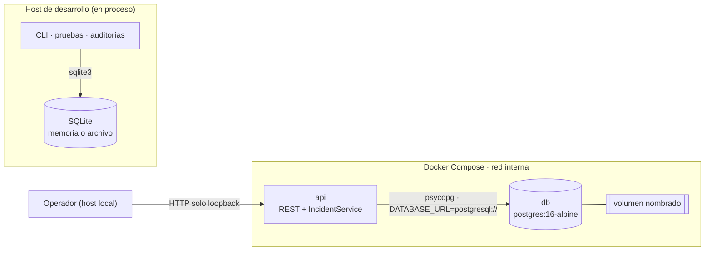

# ADR-004: Persistencia dual SQLite/PostgreSQL sin ORM en runtime multi-contenedor
- **Estado**: Propuesto
- **Fecha**: 2026-11-24
- **Autor(es)**: Equipo de Ingeniería IncidentOps
- **Reemplaza a**: ADR-001, parcialmente: solo la restricción de que `sqlite3` de la librería
  estándar sea el único motor y el único acceso a datos admitidos. El índice parcial cubriente
  (con el predicado de ADR-005), la lectura en streaming y la evaluación de SLA en Python siguen
  vigentes.
---

## 1. Contexto y Problema
El hito H004 del roadmap pide operar el servicio de forma reproducible y con los datos fuera
del proceso. Para darlo por terminado se exigen cuatro cosas:

- un entorno nuevo queda operativo sin pasos manuales;
- la base de datos relacional vive separada del proceso de aplicación, con almacenamiento
  propio y persistente;
- el chequeo de conectividad distingue «no hay base» de «la aplicación falla»;
- los datos sobreviven al reinicio del runtime.

Hoy la persistencia es SQLite embebido. El almacén por defecto vive en memoria y se siembra
con datos de demostración. El almacén en archivo vive en el mismo proceso que la API o la CLI.
Con esa topología no hay frontera de red entre aplicación y base, y el chequeo de salud no
puede fallar por falta de base: abrir un archivo local casi siempre funciona. El servicio
tampoco puede levantarse desde cero de forma idéntica en otra máquina.

Tres decisiones previas acotan el cambio:

- **ADR-003 (hexagonal)** y **ADR-006 (puerto y `DATABASE_URL`)** ya previeron un adaptador
  alterno para la base dedicada de H004. Cambiar de motor debería costar un adaptador nuevo
  más una rama en la selección por URL, sin tocar dominio ni casos de uso.
- **ADR-001** fijó «cero dependencias externas: solo `sqlite3`». La Constitución (T3 en la
  versión de spec-kit, Art. 2.6 y 3.2 en `docs/`) declara que otro motor solo se admite
  mediante un ADR aceptado que enmiende ADR-001. Este ADR es ese vehículo.
- **Constitución Art. 1.3 (determinismo).** Misma entrada y mismo instante de referencia
  deben dar el mismo resultado en cualquier canal y proceso. Esto incluye no depender del
  motor que esté detrás del puerto.

Hay más restricciones:

- Sin ORM, sin `pandas` y sin librerías de calendario (ADR-001/002 y la Constitución).
- Consultas siempre parametrizadas.
- El SLA se calcula solo en el dominio. ADR-001 ya descartó calcular tiempos en SQL porque P2
  y P3 usan horario hábil con festivos.
- El roadmap excluye autenticación, alta disponibilidad y escalado horizontal.
- Sigue abierta la pregunta del roadmap: ¿lo desplegado en H004 reemplaza al entorno de
  demostración o convive con él?

La decisión es estructural y difícil de revertir:

- Fija qué motores soporta el producto.
- Fija cómo se representan los instantes en almacenamiento, y con ello cómo quedan los datos
  ya persistidos.
- Fija qué dependencia de acceso a datos entra al proyecto.
- Fija la topología de procesos con la que se opera el servicio.

Revertirla exige migrar datos y reescribir el adaptador y el entorno de ejecución.

---

## 2. Opciones Consideradas

1. **Opción A — SQLite como único motor, persistido en un volumen y empaquetado en un solo
   contenedor**:
- *Ventajas*:
  - Ninguna dependencia nueva, y ADR-001 queda intacto.
  - Un solo adaptador y un solo dialecto SQL que mantener.
  - El índice parcial cubriente y el streaming ya están medidos sobre este motor.
  - Es la operación más simple: un contenedor y un volumen bastan para que los datos
    sobrevivan al reinicio.
- *Desventajas*:
  - No cumple el objetivo de H004: la base sigue dentro del proceso de aplicación, sin
    almacenamiento propio separado.
  - El chequeo de salud no puede distinguir «no hay base» de «la aplicación falla».
  - Escribir desde varios procesos (varios workers de `uvicorn`, o la API y la CLI a la vez)
    queda sujeto al bloqueo de archivo de SQLite. El candado único del adaptador solo
    serializa dentro de un proceso.
  - Los volúmenes de red o montados desde el host tienen bloqueo de archivos poco confiable.

2. **Opción B — PostgreSQL como único motor, con Docker Compose (`api` + `db`)**:
- *Ventajas*:
  - Un solo adaptador y un solo dialecto.
  - Base separada con red y almacenamiento propios, y un chequeo de salud con significado
    operativo real.
  - Puede usar tipos temporales nativos (`timestamptz`) sin preocuparse por la paridad con
    otro motor.
- *Desventajas*:
  - Toda ejecución necesitaría un servidor PostgreSQL en marcha: pruebas, BDD, auditorías y
    cada invocación de la CLI.
  - Se pierde el almacén en memoria con datos de demostración. Sobre él se apoyan la
    regresión, las suites de aceptación y la experiencia de curso en Windows.
  - Las pruebas pasan de ser deterministas en proceso a depender de infraestructura externa.
  - Exige tumbar el comportamiento por defecto que hoy sostienen ADR-006 y las specs
    002/003.

3. **Opción C — Persistencia dual SQLite/PostgreSQL sobre una capa de abstracción SQL
   (SQLAlchemy Core) con Docker Compose**:
- *Ventajas*:
  - Un único código de consultas para ambos dialectos.
  - Pool de conexiones, manejo de transacciones y reflexión de esquema incluidos.
  - Camino natural hacia migraciones versionadas con herramientas del mismo ecosistema.
  - Core no es un ORM de entidades, así que el dominio seguiría sin mapeo automático.
- *Desventajas*:
  - Introduce una dependencia grande y una segunda abstracción por encima del puerto. ADR-006
    ya da la independencia de motor que esta capa ofrecería, de modo que la abstracción queda
    duplicada.
  - El índice parcial, la intercalación y la migración aditiva necesitan ramas específicas
    de cada dialecto de todos modos.
  - El SQL explícito, que hoy es auditable y está medido contra el benchmark de ADR-001,
    pasa a generarse por la librería.
  - La Constitución prohíbe los ORM pesados. Admitir una librería de este tamaño reabre esa
    discusión sin una necesidad que el puerto no resuelva ya.

4. **Opción D — Persistencia dual SQLite/PostgreSQL con drivers directos, sin contenedores
   (PostgreSQL instalado en el host o como servicio gestionado)**:
- *Ventajas*:
  - Misma frontera de datos que la opción E, sin depender de Docker.
  - Usa la infraestructura que ya exista en cada máquina.
  - Menos piezas que aprender en un repositorio de curso.
- *Desventajas*:
  - No cumple «un entorno nuevo queda operativo sin pasos manuales». Instalar y configurar
    PostgreSQL cambia según el sistema operativo y la versión, y Windows es la plataforma de
    desarrollo de este repositorio.
  - La versión del servidor, la configuración regional y la inicialización quedan fuera de
    control del proyecto, así que la reproducibilidad depende de cada máquina.
  - Un servicio gestionado añade credenciales, red y costo externos, además de la
    autenticación que el roadmap deja fuera de alcance.

5. **Opción E — Persistencia dual SQLite/PostgreSQL con drivers directos (`sqlite3` +
   `psycopg[binary]`), selección por `DATABASE_URL`, instantes como texto ISO 8601 y runtime
   multi-contenedor con Docker Compose (`api` + `db` con `postgres:16-alpine`)**:
- *Ventajas*:
  - Cumple las condiciones de terminado de H004:
    - base en un contenedor propio con volumen persistente;
    - chequeo de salud con ida y vuelta real por red;
    - entorno reproducible desde cero con una sola definición declarativa.
  - SQLite sigue para desarrollo, pruebas, CLI y demostración. Con eso se responde la
    pregunta del roadmap: los dos entornos conviven.
  - El cambio queda dentro del adaptador de salida y de la raíz de composición, como
    anticiparon ADR-003 y ADR-006. Dominio, casos de uso y canales no cambian.
  - El SQL sigue escrito a mano, parametrizado y auditable.
  - `psycopg[binary]` trae su propia `libpq`, así que no hace falta compilar en Windows ni
    en la imagen.
  - Guardar los instantes como texto ISO 8601 con el mismo formato en ambos motores da la
    misma ida y vuelta en los dos. El driver no puede convertir zonas horarias por su cuenta.
- *Desventajas*:
  - Dos dialectos SQL que mantener sincronizados: DDL, migración aditiva, marcadores de
    parámetro (`?` frente a `%s`) e introspección del esquema.
  - La suite de conformidad del puerto necesita un PostgreSQL disponible.
  - Guardar instantes como texto renuncia a los tipos temporales nativos de PostgreSQL.
  - Añade Docker como requisito para operar el runtime, no para desarrollar.

---

## 3. Decisión Arquitectónica
Se adopta la **Opción E**: persistencia dual SQLite/PostgreSQL sin ORM, ejecutada en una
topología multi-contenedor con Docker Compose.

**Por qué E y no las demás.**

- A no saca la base del proceso, que es el objetivo de H004.
- B convierte una necesidad del runtime en un requisito de todo el ciclo de desarrollo y
  rompe el almacén de demostración en el que se apoyan las verificaciones.
- C duplica la independencia de motor que el puerto ya da y trae una dependencia
  desproporcionada.
- D deja la reproducibilidad en manos de cada máquina.

E es la única opción que cumple H004 y conserva a la vez el desarrollo en proceso y el
puerto tal como está.

**Elementos de la decisión.**

- **Dos adaptadores de salida, un solo puerto.**
  - El adaptador PostgreSQL implementa el mismo `IncidentRepositoryPort` que el de SQLite,
    con la misma semántica en todos sus métodos: guardar con reemplazo, insertar sin
    reemplazo con conflicto de identificador, activos por componente, abiertos por clave de
    grupo y salud.
  - El puerto no cambia y no expone nada del motor.
  - El DDL, el SQL y el mapeo fila ↔ entidad de cada motor viven solo en su adaptador.
- **Drivers directos, sin ORM ni capa de abstracción SQL.**
  - `sqlite3` de la librería estándar para SQLite y `psycopg[binary]` para PostgreSQL.
  - Toda consulta va parametrizada con el marcador propio de cada driver. La regla vigente
    pasa de «marcadores `?`» a «consultas parametrizadas, nunca concatenadas».
  - `psycopg` queda confinado a `adapters/outbound`. El dominio, la aplicación y los canales
    no lo importan, y los guardas de arquitectura deben prohibirlo fuera de esa capa, igual
    que ya prohíben `sqlite3`.
- **Selección por `DATABASE_URL`.**
  - Se amplía el mecanismo de ADR-006: además de `sqlite:///:memory:` (por defecto, con datos
    de demostración) y `sqlite:///<ruta>`, se admite el esquema `postgresql://`.
  - Solo la raíz de composición lee la variable.
  - Cualquier otro esquema sigue fallando al arrancar.
  - Como la URL de PostgreSQL lleva credenciales, la regla de ADR-006 de nombrar solo el
    esquema en los mensajes pasa a ser un requisito de seguridad.
- **Instantes como texto ISO 8601 en ambos motores.**
  - `created_at` y `resolved_at` se guardan como texto, en hora de Bogotá con desfase
    explícito y precisión fija, igual que hoy en SQLite.
  - Así los dos motores devuelven exactamente el mismo valor.
  - El orden lexicográfico coincide con el cronológico porque todos los valores comparten
    formato y desfase.
  - Ninguna regla temporal se calcula en SQL: ADR-001 y el Art. 1.1 ya la dejan en el
    dominio.
  - Con `timestamptz`, el driver devolvería instantes en la zona de la sesión. Eso abriría
    una divergencia entre motores contra el Art. 1.3.
- **Orden de texto determinista.** La base PostgreSQL usa una intercalación por bytes (`C`),
  equivalente a la `BINARY` de SQLite. Así los ordenamientos e índices sobre texto
  (identificadores con mayúsculas y minúsculas, instantes) dan el mismo resultado en los dos
  motores.
- **Topología de ejecución.**
  - Docker Compose define dos servicios en una red interna:
    - `api`: la aplicación, con `DATABASE_URL` apuntando a `db`;
    - `db`: `postgres:16-alpine`, con la versión mayor fijada y un volumen nombrado para
      los datos.
  - `api` solo se considera disponible cuando `db` responde.
  - El roadmap deja fuera la autenticación, así que la API no se publica más allá del host
    local. Esto mantiene la postura de seguridad «solo loopback» que tiene hoy.

Los dos entornos ejecutan el mismo dominio y los mismos casos de uso. Solo cambian el
adaptador de salida que elige la raíz de composición y el proceso que aloja la base.

---

## 4. Consecuencias y Trade-offs
- **Positivas**:
  - **Se cumple H004 sin tocar el núcleo.** Dominio, casos de uso, contratos de canal y
    puerto siguen igual. La prueba de que la topología hexagonal funciona como se prometió es
    que el cambio de motor cabe en un adaptador y una rama de la fábrica.
  - **Entornos que conviven.** El almacén en memoria con datos de demostración sigue siendo
    el de desarrollo, regresión, aceptación y CLI. PostgreSQL es el del runtime en
    contenedores. Esto responde la decisión pendiente del roadmap sin sacrificar ninguno de
    los dos.
  - **Salud con significado operativo.** El chequeo hace una ida y vuelta real por red, así
    que separa «la base no responde» de «la aplicación falla».
  - **Reproducibilidad.** Imagen de base fijada en la versión mayor, inicialización
    declarativa y volumen propio: un entorno nuevo queda operativo desde cero y los datos
    sobreviven al reinicio.
  - **Paridad temporal por construcción.** El mismo formato textual de instantes y la misma
    intercalación hacen que una auditoría de SLA a un instante de referencia dé el mismo
    resultado sobre cualquiera de los dos motores.
  - **Escrituras concurrentes reales.** PostgreSQL arbitra la concurrencia entre procesos, y
    el conflicto de identificador en una inserción lo resuelve la clave primaria del motor.
    El esquema «guardar y luego buscar» de H003 sigue funcionando entre procesos.
- **Negativas / Trade-offs**:
  - **Primera dependencia de acceso a datos fuera de la librería estándar.** `psycopg[binary]`
    trae su propia `libpq`: las actualizaciones de seguridad de esa librería llegan con las
    versiones de `psycopg`, no con las del sistema operativo.
  - **Dos dialectos que mantener.** DDL, introspección para la migración aditiva y
    marcadores difieren entre motores. Cada cambio de esquema se hace dos veces y la suite de
    conformidad del puerto debe correr contra ambos. Sin eso, la paridad es una suposición.
    Esto exige un PostgreSQL disponible en verificación.
  - **Rendimiento por verificar de nuevo.** El objetivo de rendimiento de ADR-001 (SC-001) se
    midió sobre SQLite. En PostgreSQL, el índice parcial cubriente solo permite lecturas sin
    tocar la tabla si el mapa de visibilidad está al día, así que la medición debe repetirse
    sobre el nuevo motor.
  - **Instantes sin tipo nativo.** PostgreSQL no valida que el texto sea un instante y no
    puede aplicar funciones temporales sin conversión explícita. Las consultas operativas o
    analíticas fuera de la aplicación pagan esa conversión. La corrección del formato depende
    de que solo el adaptador escriba en la base.
  - **Intercalación como requisito de despliegue.** Si la base se inicializa con una
    intercalación dependiente del idioma, se rompe la paridad de ordenamiento en silencio. La
    intercalación forma parte de la definición del entorno, no es un detalle opcional.
  - **Docker como requisito operativo.** El runtime en contenedores exige Docker y Compose
    en la máquina que lo opere. El desarrollo diario no lo necesita, pero la verificación
    completa del hito sí.
  - **Credenciales en la configuración.** `DATABASE_URL` pasa a contener secretos. Hay que
    tratarla como tal en la definición del entorno, en los registros y en los mensajes de
    error.
  - **Concurrencia del adaptador sin resolver aquí.** Esta decisión no adopta un pool de
    conexiones externo. Si el adaptador PostgreSQL necesita uno que implique otra
    dependencia, hace falta un ADR propio (Constitución T5).
  - **Gobernanza.** Cuando se acepte, la Constitución debe enmendarse para admitir
    PostgreSQL y `psycopg` (Art. 2.6 y 3.2 en `docs/`, T2/T3 en la versión de spec-kit), y
    ADR-001 debe registrar el reemplazo parcial. Hasta entonces, SQLite sigue siendo el único
    motor admitido.
